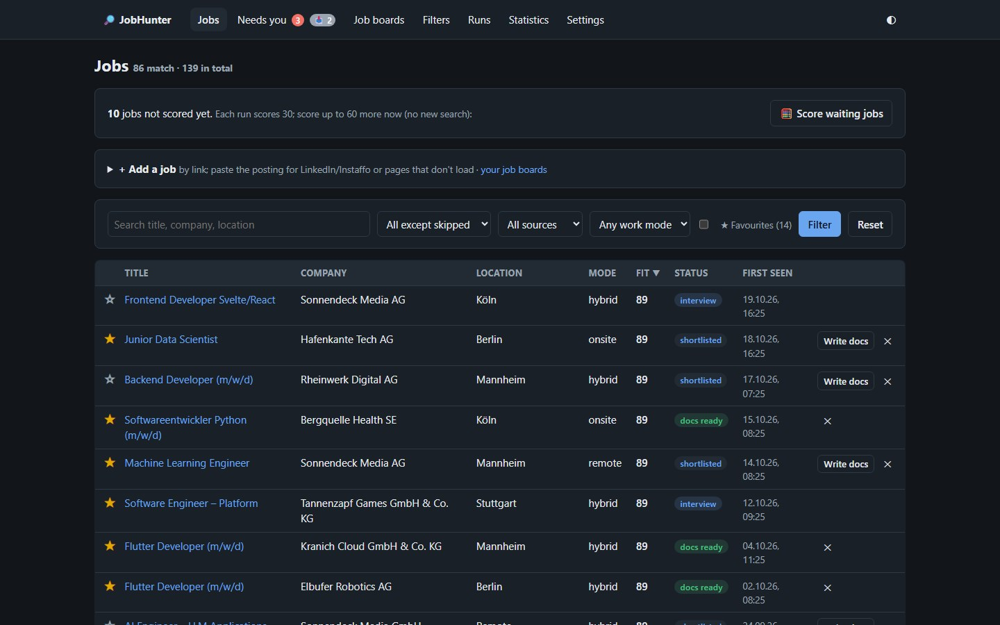
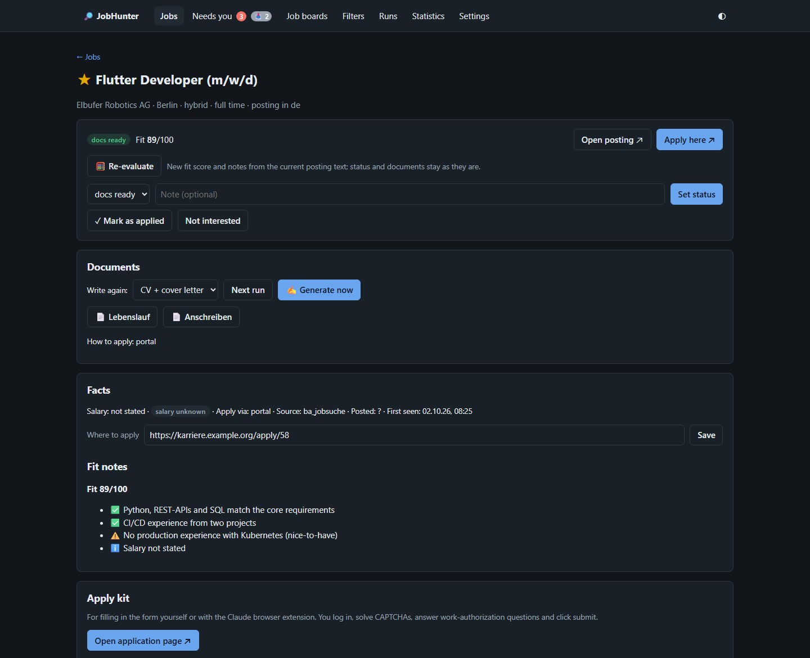
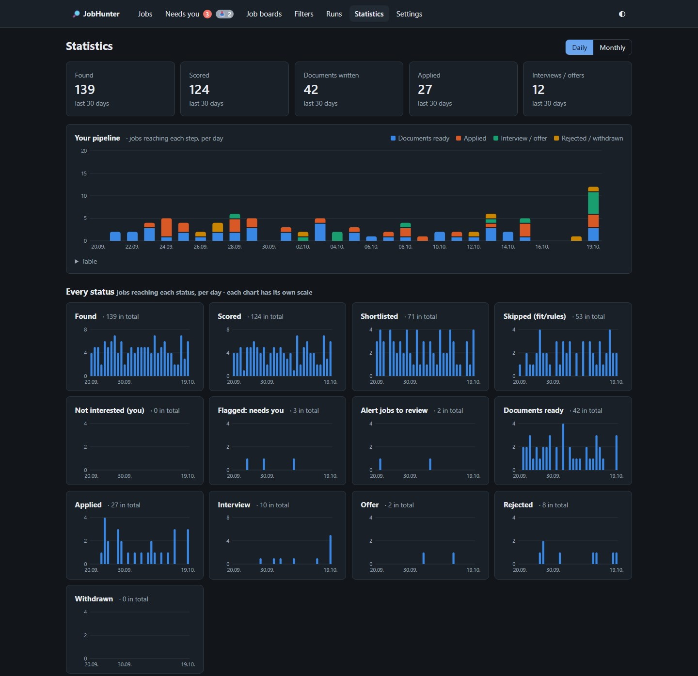

# JobHunter

A local job-search assistant, driven by **Claude Code** on a Claude subscription (no API key),
or by any OpenAI-compatible LLM provider such as Groq. Built for the German market, it works for
any country you choose (USA, UK, Canada, Nigeria, … or remote/worldwide). Twice a day it searches
job boards and your job-alert emails, scores
every new posting against your profile, writes a tailored **Lebenslauf + Anschreiben**
(DIN 5008) or **CV + cover letter**, and reports to Telegram. A local web UI is where you
review, adjust and apply. **It never submits an application — you always do.**



## What it does

- **Finds jobs:**
  - in **your target countries**: Indeed / LinkedIn / Glassdoor (via python-jobspy, about 70
    countries), plus Bundesagentur für Arbeit (official API) and Arbeitnow for Germany;
  - **remote jobs** from Himalayas and Jobicy (official APIs);
  - your **LinkedIn and Instaffo job-alert emails** (read-only IMAP: nothing is marked as read,
    no login to the boards);
  - any link you paste. Public pages, including SmartRecruiters, softgarden and SuccessFactors
    career sites, are read automatically.
- **Never handles a job twice:** URL canonicalisation plus a company/title/city fingerprint.
- **Screens deterministically:** if you need a work permit, demands such as "no visa
  sponsorship", "US citizens only" or "unbefristete Arbeitserlaubnis" are flagged for you to
  decide; with Germany as a target, the salary is also compared with the EU Blue Card threshold.
  People who don't need a permit switch this off.
- **Two models per run:**
  - a fast one (*Haiku* by default) scores the fit (0–100), classifies the job and suggests
    small projects that would close your gaps;
  - a strong one (*Sonnet* by default) writes the documents for jobs above your threshold, or
    any job you pick.
- **Truthful documents:** facts come only from your `profile.yaml`. Anything merely *implied*
  must be listed and approved by you. Style rules are enforced in code: no clichéd openers, 4–5
  paragraphs, the start date in the closing paragraph, links for every project mentioned.
- **Files ready to upload:** Typst PDFs named like
  `Max_Mustermann_Backend_Developer_Lebenslauf.pdf`.
- **Web UI** (SvelteKit), also usable from your phone over Wi-Fi with one-time pairing codes:
  - jobs table with sorting, filters and pages;
  - job pages with fit notes, PDFs and interview prep;
  - an **Apply kit** with copy buttons and a prompt for the Claude browser extension that never
    clicks submit;
  - search filters and run history;
  - **🗑 Delete** for a job, with its PDFs and history (asks first);
  - an **Applications** list, exportable as CSV or as a printable German record of your
    applications (Nachweis der Eigenbemühungen) for the Agentur für Arbeit / Jobcenter;
  - a **profile editor**, including your motivation per job category.
- **Follow-up reminders:** a Telegram message when an application has had no reply for 14 days,
  with a ready follow-up text, and again after 6 weeks.
- **Your own reminders:** set a date and time on any job (⏰). Telegram reminds you with the job,
  its JobHunter link and where to apply (link, or a tap-to-write email).
- **Recruiting agencies:** jobs posted by an agency or "on behalf of a client" get a 🤝 badge and
  **no automatic documents**; you decide per job. Keep your own list of agencies on the
  *Recruiters* page; adding one tags all its jobs at once.
- **Email drafts** (never sent) with the PDFs attached, for jobs that apply by email.

## Your setup, your choices

`uv run python cli.py setup` asks for each of these, writes secrets to `.env` and the rest to the
settings. Run it again any time; Enter keeps the current value.

| Choice | Options | Default |
|---|---|---|
| **Target countries** | Any of about 70 countries, `remote` (remote jobs in any country) and `worldwide`. Each filter can override the list | Germany |
| **AI** | `claude-code` (Claude Code on your subscription) or an OpenAI-compatible provider: Groq, OpenAI, OpenRouter, Mistral, a local Ollama, or any custom `/v1` URL. Setup lists the provider's models; you pick one for searching/scoring and one for writing | `claude-code` |
| **Drafts mailbox** | Any IMAP provider with app passwords (Yahoo, Gmail, GMX, web.de, T-Online, iCloud, or any host), or none | none |
| **Job-alert mailbox** | The drafts mailbox, a different one (any provider), or none | none |
| **Telegram** | Required: the wizard sets up the bot with you and sends a test message | — |
| **Work permit** | On: flag jobs that rule out visa sponsorship or demand citizenship / unrestricted work authorization, and (Germany only) jobs below the Blue Card salary. Off: you don't need a permit | on |
| **Search filters** | The IT starter set, or your own job titles (any field) | IT starter set |

Which boards a filter searches follows from its countries: Bundesagentur and Arbeitnow only for
Germany, Indeed/LinkedIn/Glassdoor for each target country, Himalayas and Jobicy whenever the filter
accepts remote work. Documents are written in the posting's language: German ones follow German
conventions (DIN 5008, Lebenslauf), all others are English CVs and cover letters.

**Claude Code or another provider?** Claude Code gives the best documents and costs nothing beyond
your subscription. With another provider, all the safety checks still run, because they live in
the tools rather than the model: no job twice, no sending, refused clichés, page limits, visa
wording and unapproved inferred facts. Smaller open models still invent facts more easily, so read
every CV and letter before you use it. Free tiers have low per-minute token limits: the run waits
and retries, but lower **Max. jobs evaluated / tailored per run** in Settings. Apply assist
(filling forms in the browser) needs Claude in Chrome either way.

## How it works

```
Task Scheduler ─► run.ps1 ─► claude -p (Haiku: search + score) ─► claude -p (Sonnet: documents)
                                   │                                    │
                                   └──── MCP server (Python, core/) ◄───┘
                                              │
                         SQLite (data/) · PDFs (output/) · Telegram · IMAP drafts
                                              │
                                    SvelteKit UI (localhost)
```

The full design, rules and build history are in [CLAUDE.md](CLAUDE.md), which is also the
instruction file Claude Code reads.

## Privacy

Everything runs on your PC. These are gitignored and never leave it:
- your profile (`profile/`);
- the database (`data/`);
- the generated documents (`output/`);
- the logs (`logs/`);
- all secrets (`.env`: mail app passwords, Telegram token).

Claude only sees what the MCP tools hand it: no shell, no web access, no other connectors in
scheduled runs.

## Status

| Phase | What | State |
|-------|------|-------|
| 1 | Foundation: DB, migrations, models, filters, CLI | ✅ |
| 2 | Job sources + dedup + screening (Blue Card salary, work authorization) | ✅ |
| 3 | MCP server | ✅ (document rendering and Telegram are wired in phases 4/5) |
| 4 | Documents (Typst): DE/EN CV, DIN 5008 Anschreiben, EN cover letter | ✅ |
| 5 | Scheduled workflow + Telegram | ✅ |
| 6 | Web UI | ✅ |
| 7 | Mail drafts (Yahoo via IMAP) | ✅ |
| 7a | Two-model runs, letter rules, documents on request, sortable table | ✅ |
| 8 | Apply assist | ✅ |
| 9 | Job-alert emails (LinkedIn, Instaffo; StepStone/XING prepared) | ✅ |
| + | Add jobs by link or pasted text, full postings for alert jobs, descriptive PDF names | ✅ |
| + | Shareable setup: `cli.py setup`, other LLM providers, any mail provider, work-permit switch | ✅ (macOS/Linux untested) |

## Setup: a step-by-step tutorial

This takes about 30–45 minutes the first time, and most of it is filling in your profile. You
only need a terminal. Every command below is for **PowerShell on Windows 10/11**; where macOS or
Linux differs, it says so.

> **Windows, not WSL.** Run everything on Windows itself. The scheduled task, the Python core and
> the web UI all share one SQLite file, and SQLite locking is unreliable across the WSL/Windows
> boundary.

### Step 1: Install the tools

Open **PowerShell** (Start menu → type `PowerShell`) and install what's missing:

| Tool | Why | Install | Check |
|---|---|---|---|
| **Git** | download the project | <https://git-scm.com/download/win> (the defaults are fine) | `git --version` |
| **uv** | installs Python 3.12 and the dependencies for you | `powershell -ExecutionPolicy ByPass -c "irm https://astral.sh/uv/install.ps1 \| iex"` | `uv --version` |
| **Node.js LTS** | the web UI | <https://nodejs.org> (the LTS button) | `node --version` |
| **Claude Code** (recommended) | the AI that runs the search and writes your documents | <https://claude.com/claude-code>, then run `claude` once and log in with your Claude subscription | `claude --version` |

**Close and reopen PowerShell** after installing, so the new commands are found.

Don't want Claude Code? Skip it and get an API key from an OpenAI-compatible provider instead,
for example [Groq](https://console.groq.com/keys) (has a free tier), OpenAI, OpenRouter or
Mistral, or run a local model with [Ollama](https://ollama.com). See
[Your setup, your choices](#your-setup-your-choices) for the trade-offs.

> Never set `ANTHROPIC_API_KEY`. Claude Code runs on your subscription, and the run scripts
> remove that variable on purpose.

### Step 2: Download JobHunter

Pick a folder for it (here `D:\projekte`), then:

```powershell
cd D:\projekte
git clone https://github.com/lenoben/jobhunt.git jobhunter
cd jobhunter
```

Run all later commands **inside this `jobhunter` folder**.

### Step 3: Install the dependencies

```powershell
uv sync
```

This creates a private Python environment in `.venv\` with everything JobHunter needs, including
Typst for the PDFs. Nothing is installed system-wide. It takes a minute the first time.

### Step 4: Get your passwords and keys ready

The setup wizard in the next step asks for these, so have them at hand. Only Telegram is
required; skip whatever else you don't want.

- **A mailbox for email drafts.** For jobs that apply by email, JobHunter saves a ready email with
  your PDFs as a *draft*; it never sends anything. You need an **app password**, never your
  normal password:
  - Yahoo: <https://login.yahoo.com/account/security> → *Generate app password*;
  - Gmail: turn on 2-Step Verification, then <https://myaccount.google.com/apppasswords>;
  - GMX / web.de: enable IMAP in the mail settings (and use an app password if you have
    two-factor login).
- **A mailbox with your job alerts.** If you get LinkedIn or Instaffo job-alert emails,
  JobHunter can read them read-only: nothing is marked as read, deleted or moved. It can be the
  same mailbox as above or a different one, even with a different provider.
- **Telegram (required)**: run summaries, jobs that need you and failed runs arrive there. Install
  Telegram on your phone and sign in. The wizard then walks you through creating a bot with
  [@BotFather](https://t.me/BotFather) (`/newbot`, pick a name, copy the **bot token**).
- **A Himalayas API key** (optional, free at <https://himalayas.app/api>) for the remote-jobs
  board. Without one, JobHunter uses Himalayas' shared public allowance.
- **An LLM API key**, only if you chose another provider than Claude Code in Step 1.

### Step 5: Run the setup wizard

```powershell
uv run python cli.py setup
```

It asks one question at a time. The value in `[brackets]` is the default: press **Enter** to
take it. Passwords and keys are typed hidden and never shown again. What it asks:

| Part | Question | What to answer |
|---|---|---|
| 1. Requirements | — | Shows ✓/✗ for Claude Code, Node, npm and Typst. Install anything marked ✗ that you need |
| 2. Your files | — | Creates `.env` (your secrets) and `profile/profile.yaml` (your data) from the examples |
| 3. AI | **Provider** | `1` for `claude-code`, or your provider's number |
| | **Models** | Claude Code: Enter keeps *haiku* for scoring and *sonnet* for writing. Other providers: the wizard lists the provider's models; pick a **fast, cheap** one for searching/scoring and a **strong** one for writing |
| 4. Countries | **Countries** | Numbers from the list or names, comma-separated, e.g. `2, 3, remote` for USA, UK and remote jobs. Then the optional Himalayas key |
| 5. Email | **Save application emails as drafts?** | `y`, then the address and the app password; or `n` |
| | **Read job alerts from** | the drafts mailbox, another mailbox, or none |
| 6. Telegram | **Bot token** | Paste the token from @BotFather. The wizard checks it, asks you to send your bot a message, finds your chat by itself and sends a test message. It doesn't continue until that worked |
| 7. Work permit | **Do you need a work permit?** | `y` if you need a visa or sponsorship where you apply: jobs that rule it out (and, for Germany, jobs below the EU Blue Card salary) are flagged for you to decide. `n` if you don't (e.g. citizens) |
| 8. Search filters | **Use the IT starter set?** | `y` for software, AI/data, web/app, DevOps, embedded and fintech/health-tech roles. `n` to type your own, one per line, e.g. `Nursing: Registered Nurse, Pflegefachkraft`, then an empty line |

The mail server is found from your address (`@gmail.com`, `@yahoo.com`, `@gmx.de`, `@web.de`,
`@t-online.de`, `@icloud.com`). For any other address the wizard asks for the IMAP host.

Made a mistake? Run `uv run python cli.py setup` again. It's safe to repeat, and Enter keeps
everything you already answered. Ctrl+C stops it; the parts you already finished stay saved.

### Step 6: Fill in your profile

Open `profile\profile.yaml` in any text editor (e.g. `notepad profile\profile.yaml`). **This file
is the only source of facts for your CVs and letters.** JobHunter never invents anything, so
whatever is missing here won't appear in your documents. Fill in:

- `personal`: name, address, email, phone, and optionally a photo path (German CVs only);
- `summary_de` / `summary_en`: a few lines about you;
- `experience`, `education`, `projects`, `certificates`: dates as `MM/YYYY`, bullets in German
  and English, links for projects;
- `skills`, and `languages` with CEFR levels like `B2`;
- `availability`: earliest start date and hours per week;
- `motivation`: one short paragraph per search filter (*why do you want this kind of job?*). The
  cover letters open with it.

**Shortcut:** in the `jobhunter` folder, run `claude` and say *"Fill in profile/profile.yaml from
my CV at C:\path\to\cv.pdf. Ask me about every gap, don't guess."* Then read every line yourself.

Check the file:

```powershell
uv run python cli.py check-profile
```

### Step 7: Test what you set up

Every test is safe: nothing is sent and nothing is applied to. Skip the ones for things you
didn't set up.

```powershell
uv run python cli.py render-test                  # sample CVs and letters → output\_render-test\
uv run python cli.py mail-test                    # logs in to the drafts mailbox, finds the Drafts folder
uv run python cli.py mail-test --account alerts   # logs in to the job-alert mailbox (read-only)
uv run python cli.py telegram-test                # sends a test message (the wizard already did once)
```

`mail-test --create` also saves one draft called *JobHunter test* to your own address, so you
can see it in your mailbox.

### Step 8: Start the web UI

```powershell
cd ui
npm install          # once, and after updates
npm run build        # once, and after updates
npm start            # then open http://localhost:5173
```

Leave this window open while you use the UI. The UI only answers on this PC unless you allow
your phone ([see below](#phones-and-tablets-on-the-pcs-mobile-hotspot)). Have a look around:
**Filters** shows your search filters, and **Settings** has the limits, models and switches.

### Step 9: Your first run

Open a **second** PowerShell window in the `jobhunter` folder:

```powershell
.\run.ps1 -Trigger manual
```

The first run takes a few minutes. It searches every active filter, scores the new jobs and
writes CVs for the best ones. The log goes to `logs\`. Then refresh the UI: new jobs appear under
**Jobs**, anything that needs you under **Needs you**, and the run itself under **Runs**.

> With another LLM provider on a free tier, first lower **Max. new jobs evaluated per run** and
> **Max. jobs tailored per run** in Settings (e.g. to 10 and 2). The run waits when it hits the
> provider's rate limit, but smaller runs finish sooner.

### Step 10: Run it automatically twice a day

```powershell
.\setup-task.ps1
```

This registers the Windows task **JobHunter**. It runs at 08:00 and 18:00, catches up after the
PC was off, and runs only while you're logged on, so no password is stored. Run the script again
after changes; it updates the task. You'll find it in *Task Scheduler* as **JobHunter**.

It also registers **JobHunter reminders**, which checks every 15 minutes for the reminders you set
on jobs and sends them via Telegram. It is plain Python (no AI, no cost) and shows no window.

**macOS/Linux (not tested yet):** `chmod +x run.sh`, then `crontab -e` and add
`0 8,18 * * * cd /path/to/jobhunter && ./run.sh scheduled` and, for reminders,
`*/15 * * * * cd /path/to/jobhunter && .venv/bin/python cli.py reminders --notify`.

### Every day

1. Read the Telegram summary, or open the UI.
2. Check **Needs you**: approve or reject inferred facts, and decide on flagged jobs.
3. Open a job, read the fit notes, download the PDFs, and use the **Apply kit** to fill in the
   form. **You** always submit.
4. Click **Mark as applied**. JobHunter reminds you to follow up after 14 days.

### Updating

```powershell
git pull
uv sync
cd ui; npm install; npm run build; cd ..
```

Database changes are applied automatically on the next run. An update never touches your
`.env`, `profile\`, `data\` or `output\`.

### Troubleshooting

| Problem | Fix |
|---|---|
| `uv`, `claude` or `node` "is not recognized" | Close and reopen PowerShell after installing. Still missing: reinstall it |
| "running scripts is disabled on this system" | `Set-ExecutionPolicy -Scope CurrentUser RemoteSigned`, then try again |
| `mail-test` can't log in | Use an **app password**, not your normal one. GMX/web.de: enable IMAP in the mail settings first |
| `mail-test`: "No Drafts folder" | Open your webmail once so the Drafts folder exists |
| A run is "refused" | The last run finished less than 4 hours ago (setting **Min. hours between runs**). Use **Generate now** for documents, or wait |
| Other provider: "setting llm_model_writer is empty" | Run `uv run python cli.py setup` again and pick the models |
| Other provider: HTTP 401 | `LLM_API_KEY` in `.env` is wrong or expired |
| A document claims something untrue | Fix `profile.yaml` (the only source of facts), then click **Write documents** again on the job page |

<details><summary>Manual setup instead of the wizard</summary>

```powershell
Copy-Item .env.example .env               # then fill it in by hand; the comments explain each key
New-Item -ItemType Directory -Force profile
Copy-Item profile.example.yaml profile/profile.yaml
uv run python cli.py init-db              # creates data/jobhunter.db
uv run python cli.py seed-filters         # inserts the IT starter filters
```
</details>

## Reference

### Mail settings in `.env` (two accounts)

| Account | Used for | Access |
|---------|----------|--------|
| **SEND** (`SEND_*`) | Application emails, saved as **drafts** (never sent) | creates drafts only |
| **ALERTS** (`ALERTS_*`) | Reading LinkedIn/Instaffo job-alert emails (StepStone/XING prepared) | read-only: no drafts, no sending, nothing marked as read |

Both are optional and generic IMAP over SSL with app passwords, so any provider works, and the
two can be different providers. The IMAP host comes from `<ROLE>_IMAP_HOST` if set, else from
`<ROLE>_MAIL_PROVIDER` (`yahoo`, `gmail`, `gmx`, `webde`, `t-online`, `icloud`), else from the
address (`@gmail.com` → `imap.gmail.com`, …). If you leave
`ALERTS_MAIL_ADDRESS`/`ALERTS_MAIL_APP_PASSWORD` empty, alerts are read from the SEND account,
still read-only. Without SEND no drafts are saved; with neither, the job-alert source finds
nothing. Outlook.com/Hotmail no longer accepts app passwords over IMAP, so it isn't supported.

Gmail: turn on 2-Step Verification, then create an app password at
<https://myaccount.google.com/apppasswords>. GMX / web.de: enable IMAP access in the mail
settings (and use an app password if you have two-factor login).

**Create a Yahoo app password** (your normal Yahoo password never goes into this project):
1. Sign in at <https://login.yahoo.com/account/security>.
2. Open **Generate app password** (also called "App passwords"). If it isn't offered, turn on
   two-step verification on the same page first.
3. Enter a name such as `JobHunter` and click **Generate**.
4. Copy the 16-character password into `SEND_MAIL_APP_PASSWORD` (or `ALERTS_MAIL_APP_PASSWORD`)
   in `.env`. Yahoo shows it only once. If you lose it, delete it and create a new one. Use one
   app password per account.

| Key | Yahoo value |
|-----|-------------|
| `SEND_MAIL_ADDRESS` / `ALERTS_MAIL_ADDRESS` | your address, e.g. `you@myyahoo.com` |
| `SEND_MAIL_APP_PASSWORD` / `ALERTS_MAIL_APP_PASSWORD` | the app password from above |
| `SEND_IMAP_HOST` / `ALERTS_IMAP_HOST` | `imap.mail.yahoo.com` |
| `SEND_IMAP_PORT` / `ALERTS_IMAP_PORT` | `993` |

Test with `uv run python cli.py mail-test` (SEND account), which logs in and shows the folders and
the Drafts folder. `mail-test --create` saves one draft with the subject `JobHunter test` to your
own address. The Drafts folder is the one with the IMAP `\Drafts` special-use flag; if no folder
has the flag, a folder named `Draft` (Yahoo), `Drafts` or `Entwürfe` (GMX, web.de, T-Online) is used.
`mail-test --account alerts` only checks the ALERTS login and lists its folders.

## CLI

| Command | Does |
|---------|------|
| `setup` | Guided setup: AI provider and models, target countries, mailboxes, Telegram (required), work permit, search filters. Safe to run again |
| `agent --stage S [--trigger T] [--job N]` | One run stage with another LLM provider (used by `run.ps1`/`run.sh`) |
| `init-db` | Creates `data/jobhunter.db` (WAL mode) and applies pending migrations from `core/migrations/` |
| `seed-filters` | Inserts the default search filters (skips ones that already exist by name) and lists them |
| `filters` | Lists all search filters |
| `search --filter N [--source S] [--limit 20] [--dry-run]` | Runs one filter against the sources that cover its countries (`ba_jobsuche`, `arbeitnow`, `jobspy`, `himalayas`, `jobicy`, `email_alerts`), drops jobs already seen, screens salary and work-authorization wording, stores new jobs. `--dry-run` stores nothing. |
| `telegram-setup` / `telegram-test` | Print your chat id after you messaged the bot / send a test message |
| `notify-failure [--reason R] [--log L]` | Used by `run.ps1`: marks open runs as failed and sends "🛑 Run failed" |
| `check-run --since "YYYY-MM-DD HH:MM:SS"` | Used by `run.ps1`: exit 1 if a run started since then never finished |
| `add-job --url URL [--text-file F] [--title T] [--company C]` | Add a job by link (public pages are read automatically; LinkedIn/Instaffo need the pasted text). Screened like any other job |
| `update-posting JOB --text-file F` | Add/replace a job's full posting (e.g. one from an alert email); the job is screened and evaluated again |
| `recruiters list\|add\|update\|remove\|clear-job` | Your list of recruiting agencies (`--name` per spelling, `--note`, `--id`, `--job`). `add` tags every stored job of that company at once; their jobs never get documents unless you request them |
| `reminders [--notify]` | Job reminders that are due; `--notify` sends them via Telegram (the task *JobHunter reminders* runs this every 15 minutes) |
| `rename-documents` | Rename old `cv.pdf`/`anschreiben.pdf` files to `<Name>_<Job title>_<Document>.pdf` |
| `render-test` | Renders CV + letter in German and English from `templates/examples/` into `output/_render-test/` and checks the page limits (CV ≤ 2, letter = 1) |
| `mail-test [--account send\|alerts] [--create [--job N]]` | Checks the IMAP login. SEND (default): finds the Drafts folder; with `--create`, saves a `JobHunter test` draft to **your own** address. With `--job N`, that job's CV and letter are attached. Afterwards it checks, read-only, that the draft is in Drafts with exactly those attachments and not in Sent. ALERTS: login and folder list only. Never sends. |

Run the tests with `uv run pytest`.

## MCP server

`.mcp.json` registers the `jobhunter` server for Claude Code (`uv run python -m mcp_server.server`).
The first time you open Claude Code in this folder it asks whether to trust the project's MCP
server; say yes. Check it with `claude mcp list`, which should show `jobhunter … ✔ Connected`.
`uv` must be on your PATH: open a new terminal after installing uv.

Tools: `start_run`, `get_active_filters`, `get_settings`, `search_jobs`, `is_seen`, `get_job`,
`get_profile`, `evaluate_job`, `render_documents`, `save_application`, `flag_attention`,
`save_email_draft` (draft only, never sends), `finish_run`. See CLAUDE.md §6.

## Documents

Typst templates in `templates/` (no LaTeX needed; the `typst` Python package compiles them). The
German letter follows DIN 5008 Form B. Claude only writes the content as JSON (schema = the files
in `templates/examples/`), and `output/<job_id>/` gets `cv.pdf` plus `anschreiben.pdf` or
`cover_letter.pdf`, along with `content.json` and `notes.md`.

If Claude adds something your profile implies but doesn't state (e.g. a closely related tool),
it has to list it with its reason. The job then shows up under *needs attention*
(`inferred_facts`) until you approve it, and no email draft is made before that.

## Web UI

```powershell
cd ui
npm install          # once
npm run build        # once, and after updates
npm start            # http://localhost:5173 (local only)
```

`npm run dev` also works while developing. The UI has these pages:
- **+ Add a job:** paste a link, plus the full posting if the page needs a login. With *Evaluate
  now*, Haiku scores it right away, and Sonnet writes the documents if it meets your threshold.
- **Jobs:** filter and search; click a column header to sort (click again to reverse, e.g. by
  fit score); 25/50/100 per page. Row buttons: **Apply anyway** for skipped jobs, **Write docs**
  for jobs without documents, ✕ **Not interested**, and 🗑 **Delete** (asks *Delete job?* first). While requested documents are waiting,
  a **Generate now** button writes them right away instead of in the next scheduled run.
- **Job page:** full posting, fit notes, **project suggestions** for the gaps, PDFs, `notes.md`
  and interview prep, a status dropdown with a note, **Mark as applied**, the history, and 🗑 **Delete**: after you confirm, it removes the job,
  its PDFs (`output/<id>/`) and its history for good. A deleted job is never added again by a
  run; email drafts already in your mailbox stay. Under
  **Full posting** you can paste the complete ad (alert emails only contain the title), then
  **Save & evaluate now**. You can
  request **CV only, cover letter only, or both**, for the next run or **Generate now**.
- **Needs you:** approve or reject inferred facts, and resolve flagged jobs.
- **Recruiters:** your list of recruiting agencies (name, other spellings, note). Adding one tags
  all jobs of that company you already have, and lists them. Jobs the AI recognised as posted by
  an agency are listed too: add the agency, or clear the badge. On a job page: **✕ Not a
  recruiter**, or **Add to my recruiter list**.
- **⏰ Reminder** on every job page: date, time and a note; the Jobs list can show only jobs with
  a reminder.
- **Filters:** create, edit, switch on/off and delete. Each filter can have its own
  **countries** (empty = the default from Settings).
- **Runs:** the run history.
- **Settings:** target countries, limits, models, Telegram on/off, the work-permit checks and
  Blue Card threshold, and **Run now**.

<p>
  
  
</p>

*Left: a job page with its fit notes, documents and Apply kit. Right: Statistics, your pipeline
per day and one chart per status.*

**Apply kit** (on each job with documents) has:
- the application link and the PDF paths to upload;
- every form value with a **Copy** button (name, first/last name, email, phone, address, start
  date, hours, salary, links, short motivation);
- a ready-made **prompt for the Claude browser extension**: it fills the form, uploads the files,
  leaves work-authorization/visa questions empty, and never submits;
- **Flag: work authorization**, for forms that demand it.

In Claude Code you can also say "help me apply to job 42", which uses the `apply-assist` skill.
You always log in, solve CAPTCHAs, answer work-permit questions and click submit yourself.
`cli.py apply-kit N` prints the same prompt.

The UI rejects requests from other websites. By default it only answers on this PC.

### Phones and tablets on the PC's Mobile Hotspot
1. In `.env`, set `UI_LAN=1`, `UI_LAN_SUBNETS=192.168.137.0/24` and a `UI_SESSION_SECRET`
   (see `.env.example`). Then restart the UI (`npm start`).
2. Turn on **Windows Settings → Network → Mobile hotspot** and connect the phone to it.
3. On the PC, open **Settings → Pair a device** to get a 6-digit code. It is valid for 10 minutes
   and works once.
4. On the phone, open `http://192.168.137.1:5173/` and enter the code. The phone stays signed in
   for a year.

To use your normal Wi-Fi as well, add its range to `UI_LAN_SUBNETS`, e.g.
`192.168.137.0/24,192.168.0.0/24`, and open `http://<PC address>:5173/` (here
`http://192.168.0.157:5173/`). Do this only on a network you trust: the UI uses plain HTTP.
Devices on networks not listed are always refused. To sign out every device, change
`UI_SESSION_SECRET`.

## Scheduled runs and Telegram

1. **Telegram** is set up by `cli.py setup`. By hand: create a bot with
   [@BotFather](https://t.me/BotFather), put the token into `TELEGRAM_BOT_TOKEN`, send the bot any
   message, run `uv run python cli.py telegram-setup`, put the printed id into
   `TELEGRAM_CHAT_ID`, and check with `cli.py telegram-test`.
2. **Manual run:** `.\run.ps1 -Trigger manual`. `.\run.ps1 -Trigger docs` writes only the requested documents. Claude works headless with only the JobHunter
   tools. Logs go to `logs/run_<time>_<trigger>.log`.
3. **Schedule:** `.\setup-task.ps1` registers the task **JobHunter**. It runs daily at 08:00 and
   18:00, catches up after the PC was off, wakes the PC, needs network, and stops after 2 h at
   most. It runs only while you're logged on, so no password is stored. Run the script again
   after changes; it updates the task.
   **macOS/Linux (untested):** `chmod +x run.sh`, then `crontab -e` and add
   `0 8,18 * * * cd /path/to/jobhunter && ./run.sh scheduled`.

Each run has two stages:
- a fast model searches, filters and scores: **Haiku** by default (setting `model_filter`), or
  `llm_model_filter` with another provider;
- a strong model writes CVs and cover letters: **Sonnet** (`model_writer`), or
  `llm_model_writer`.

With `LLM_PROVIDER` other than `claude-code`, `run.ps1`/`run.sh` run each stage with
`cli.py agent` instead of `claude -p`: the same skill, the same MCP tools, your provider's models.

Documents are written automatically for jobs with fit ≥ `min_fit_for_documents` (60), and for
any job where you clicked *Apply anyway* or *Write docs*. All three settings are editable in the
UI.

A run is refused if one is still running or the last one finished less than
`min_hours_between_runs` (4 h) ago. *Generate now* runs don't wait for that gap. Each run evaluates at most `max_evaluated_per_run` (30) new
jobs and tailors at most `max_tailored_per_run` (5); the rest carry over. After each run you get
one Telegram message: the counts, then short sections (📄 documents ready, ⭐ shortlisted,
🤝 via a recruiter, ⚠️ needs you, 🛠 problems), each job with company, place, fit and a link.

## Job sources

| Key | Boards | Notes |
|-----|--------|-------|
| `ba_jobsuche` | Bundesagentur für Arbeit | Official API. Germany only. Salary is rarely given. |
| `himalayas` | [Himalayas](https://himalayas.app) remote jobs | Official API. Remote jobs open to your target countries (or worldwide), **last 7 days only**. Up to 3 keywords per filter and country, 20 per page. Optional free key `HIMALAYAS_API_KEY`. Each query is cached for **6 hours**. |
| `jobicy` | [Jobicy](https://jobicy.com) remote jobs | Official API. One feed of the last 7 days, downloaded at most every **6 hours** and matched to every filter locally (keywords; country or region such as *Europe*, *EMEA*, *Anywhere*). |
| `arbeitnow` | Arbeitnow | Public API; one shared feed, matched to filters locally. Only jobs from the German site (arbeitnow.com) are kept; .co.uk/.fr/.ch/.nl and foreign locations are dropped. |
| `email_alerts` | Your LinkedIn job-alert emails (StepStone/XING prepared) | Reads the ALERTS mailbox **read-only**: nothing is marked as read, no LinkedIn login, no requests to LinkedIn. Each mail is processed once. Only jobs matching a filter's keywords are stored. Senders and folder are editable in Settings. |
| `jobspy` | Indeed, LinkedIn, Glassdoor | Scraped, for each target country (Indeed's site of that country; Glassdoor where it exists; `remote`/`worldwide` = LinkedIn "Worldwide"). Max 20 per site per filter, shared between the countries, 3 s between requests. LinkedIn often blocks; that is recorded as an error and the other sites continue. (Google Jobs was removed: it never returned results.) |

A source that doesn't cover a filter's countries is skipped, not counted as an error
(Bundesagentur and Arbeitnow: Germany only; Himalayas and Jobicy: only filters that accept remote
work).

Himalayas and Jobicy ask to be named as the source and to keep their apply links, and they
forbid passing their jobs on to other job boards. JobHunter shows them as the source, keeps their
links and keeps the jobs on your PC, so use it for your own job search only.

Each new job is screened before it is stored (when the work-permit checks are on):
- **Salary** (only with Germany as a target): converted to gross EUR per year (upper value of a
  range) and compared to the EU Blue Card threshold in the `blue_card_salary_min` setting (45,934.20 € for 2026). Below → *needs
  attention*. No salary → `salary_unknown` (informational only).
- **Work authorization:** ads asking for e.g. *unbefristete Arbeitserlaubnis*,
  *EU-Staatsbürgerschaft*, *no visa sponsorship*, *will not sponsor*, *US citizens only* or
  *authorized to work … without sponsorship* → *needs attention*, so you answer those yourself.

## Where things live

| Path | Contents | In git? |
|------|----------|---------|
| `profile/profile.yaml` | Your CV data — the only source for generated documents | no |
| `data/jobhunter.db` | Jobs, applications, filters, runs | no |
| `output/<job_id>/` | Generated PDFs and notes | no |
| `logs/` | One log per run | no |
| `.env` | Telegram token, SEND and ALERTS mail app passwords, LLM and Himalayas keys | no |
| `data/cache/` | Himalayas and Jobicy responses, reused for 6 hours | no |

## Schema changes

Add a new numbered file such as `core/migrations/002_something.sql`. `init-db` (and every
connection that calls `migrate`) applies files it has not seen yet, recorded in
`schema_migrations`. Never edit a migration that has already been applied.
